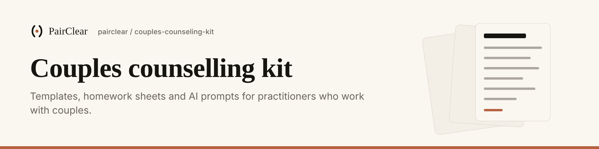
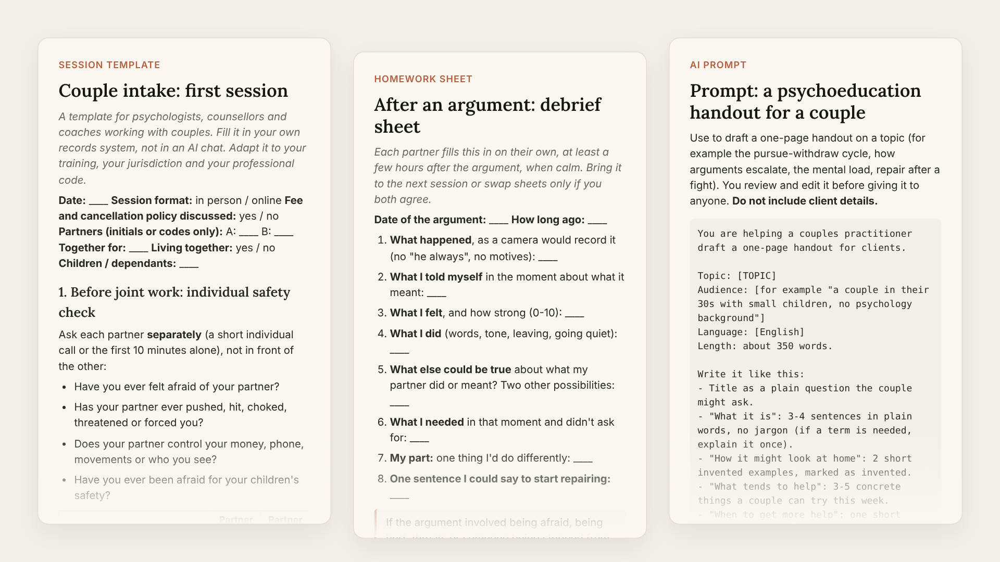

<a href="https://pairclear.com/en/experts/?utm_source=github&utm_medium=readme&utm_campaign=couples-counseling-kit"><picture>
  <source media="(prefers-color-scheme: dark)" srcset="assets/banner-dark.png">
  
</picture></a>

# Couples counselling kit: free templates, homework sheets and AI prompts for practitioners

[Русская версия](README.ru.md) · [Templates](en/templates/) · [Homework](en/homework/) · [AI prompts](en/prompts/) · [Using AI safely](en/guides/using-ai-safely.md) · [Claude skill](SKILL.md)

    

> **For trained practitioners.** These are working materials, not a method, a treatment protocol or a substitute for training and supervision. They have not been reviewed by a clinician. Adapt them to your training, your professional code and your country's law. No real client data appears anywhere in this repo: every example is invented. If a client is in danger, the usual route applies: emergency services (112 in Europe, 911 in the US and Canada) or a helpline from [findahelpline.com](https://findahelpline.com).

## See it in action

Psychologists, counsellors and coaches who see couples keep rewriting the same intake forms, homework sheets and handouts. This is a free, editable set in English and Russian, plus prompts for using AI on the parts where it helps (drafting, simplifying, practising) and not where it doesn't (client data, diagnosis, risk).

## What's inside

**Session templates** ([en](en/templates/) · [ru](ru/templates/))

| Template | Notes |
|---|---|
| [Couple intake](en/templates/intake-couple.md) | Starts with an **individual** safety check for violence and coercive control, before joint work |
| [Session plan](en/templates/session-plan.md) | 50-minute structure with an escalation plan |
| [Session notes](en/templates/session-notes.md) | Observations separate from hypotheses, risk section |
| [Progress review](en/templates/progress-review.md) | Every 4-6 sessions, goals revisited by each partner |

**Homework sheets for couples** ([en](en/homework/) · [ru](ru/homework/))

| Sheet | Use it for |
|---|---|
| [After an argument: debrief](en/homework/conflict-debrief.md) | Separating what happened from what I told myself |
| [Weekly check-in](en/homework/weekly-check-in.md) | A 20-minute weekly ritual |
| [Appreciation log](en/homework/appreciation-log.md) | Noticing what still works |
| [Starting gently](en/homework/gentle-start.md) | Rewriting harsh first sentences |
| [Time-out plan](en/homework/time-out-plan.md) | An agreed pause for heated arguments |
| [Mental load inventory](en/homework/mental-load-inventory.md) | Who notices, plans and does what at home |
| [Repair menu](en/homework/repair-menu.md) | What helps each partner de-escalate and reconnect |

**AI prompts for the practitioner** ([en](en/prompts/) · [ru](ru/prompts/))

| Prompt | What it does |
|---|---|
| [Psychoeducation handout](en/prompts/psychoeducation-handout.md) | Drafts a one-page handout with invented examples, a safety line and no invented sources |
| [Adapt homework](en/prompts/adapt-homework.md) | Simplifies or tailors a sheet without client details |
| [Structure notes safely](en/prompts/structure-notes-safely.md) | Turns de-identified rough notes into a structure, adding nothing |
| [Practice role-play](en/prompts/practice-roleplay.md) | An invented couple to rehearse skills with, feedback on request |
| [Plain-language check](en/prompts/plain-language-check.md) | Finds jargon, blame, overclaims and missing safety lines |

**Guide:** [Using AI tools in couples work](en/guides/using-ai-safely.md): good and bad uses, GDPR basics, a consent paragraph to adapt.

## Quick start

- **Print or copy a sheet:** open it on GitHub, copy into your editor, adapt, print. They're plain Markdown so they paste cleanly into Word, Google Docs, Notion or Obsidian.
- **Use the prompts:** copy the block into ChatGPT, Claude or another tool you're allowed to use. Never paste identifiable client information into a consumer chat.
- **In Claude:** add [`SKILL.md`](SKILL.md) as a skill.

## Principles behind the kit

- **Safety screening comes first in couples work.** Joint sessions can be risky when there is violence or coercive control, so the intake starts with an individual check, and several sheets say when not to use them.
- **Relationship, not pathology.** The sheets work with patterns between two people. Clinical assessment is out of scope.
- **No blame, no labels, no "leave or stay"** in client-facing texts.
- **AI drafts, you decide.** Every prompt forbids invented citations and diagnosis, and keeps a safety line.

## FAQ

**Is this an evidence-based protocol?** No. The sheets use common, widely taught ideas in couples work (debriefing conflict, time-outs, gentle start-ups, repair attempts, sharing the mental load) in our own wording. They are not a validated intervention.

**Can I put my logo on them and give them to clients?** Yes. CC BY 4.0: keep a short credit, for example "Adapted from couples-counseling-kit by PairClear".

**Can I use AI to write my session notes?** Maybe, depending on your professional code, your clients' consent and data-protection law. Read [the guide](en/guides/using-ai-safely.md) first.

**Who wrote it?** The PairClear team, with AI assistance. Not reviewed by a clinician yet; corrections from practitioners are very welcome.

## Related

- [Relationship questionnaires](https://github.com/pairclear/relationship-questionnaires): seven short, open, browser-only questionnaires to use as conversation starters
- [Not a therapist](https://github.com/pairclear/not-a-therapist): safety rules and crisis lines for AI chats on personal topics
- [PairClear](https://pairclear.com/en/?utm_source=github&utm_medium=readme&utm_campaign=couples-counseling-kit): articles and quizzes about what happens between two people

## Contributing

Corrections from practitioners, new sheets and translations are welcome. Keep the same structure in `en/` and `ru/`, keep examples invented, and keep the safety notes.

## More free tools from PairClear

| Repo | What it is |
|---|---|
| [16 associations](https://github.com/pairclear/sixteen-associations) | Write 16 words about one topic and merge them in pairs down to one |
| [Psychology lenses](https://github.com/pairclear/psychology-lenses) | One situation through Freud, Jung, CBT and 5 more schools |
| [Reflection journal](https://github.com/pairclear/reflection-journal) | Questions after a fight, before a hard talk, weekly check-in |
| [Thoughts after a fight](https://github.com/pairclear/conflict-thought-diary) | A CBT thought diary for conflicts with a partner |
| [Not a therapist](https://github.com/pairclear/not-a-therapist) | Safety rules for AI chats about relationships |
| [Relationship questionnaires](https://github.com/pairclear/relationship-questionnaires) | Seven short open questionnaires, scored in your browser |

All tools and articles: [pairclear.com](https://pairclear.com/en/?utm_source=github&utm_medium=readme&utm_campaign=couples-counseling-kit) · [github.com/pairclear](https://github.com/pairclear)

## Licence

All materials: [CC BY 4.0](LICENSE). Written with AI assistance.
