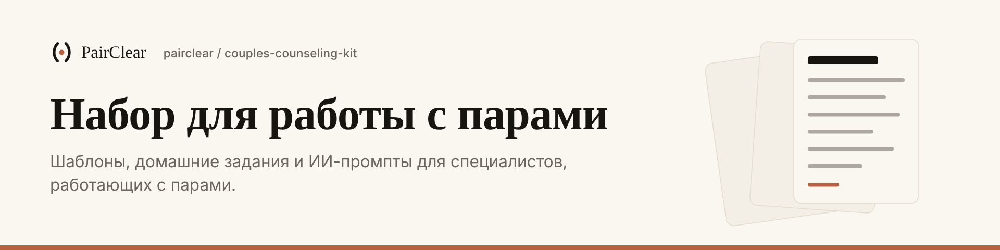
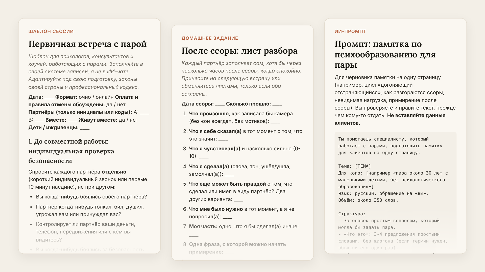

<a href="https://pairclear.com/ru/experts/?utm_source=github&utm_medium=readme&utm_campaign=couples-counseling-kit"><picture>
  <source media="(prefers-color-scheme: dark)" srcset="assets/banner-dark.ru.png">
  
</picture></a>

# Набор для работы с парами: бесплатные шаблоны, домашние задания и ИИ-промпты для специалистов

[English](README.md) · [Шаблоны](ru/templates/) · [Домашние задания](ru/homework/) · [ИИ-промпты](ru/prompts/) · [ИИ без риска](ru/guides/using-ai-safely.md) · [Навык для Claude](SKILL.md)

    

> **Для специалистов с подготовкой.** Это рабочие материалы, а не метод, протокол лечения или замена обучению и супервизии. Клиницист их не проверял. Адаптируйте под свою подготовку, профессиональный кодекс и законы своей страны. Реальных данных клиентов в репозитории нет: все примеры выдуманы. Если клиенту угрожает опасность, действует обычный порядок: экстренные службы (112 в Европе, 911 в США и Канаде) или горячая линия с [findahelpline.com](https://findahelpline.com).

## Как это выглядит

Психологи, консультанты и коучи, которые работают с парами, раз за разом переписывают одни и те же анкеты, листы домашних заданий и памятки. Здесь бесплатный редактируемый набор на русском и английском, плюс промпты для ИИ там, где он помогает (черновики, упрощение, тренировка), и предупреждения там, где нет (данные клиентов, диагнозы, риски).

## Что внутри

**Шаблоны для сессий** ([ru](ru/templates/) · [en](en/templates/))

| Шаблон | Особенности |
|---|---|
| [Первичная встреча с парой](ru/templates/intake-couple.md) | Начинается с **индивидуальной** проверки на насилие и контроль, до совместной работы |
| [План сессии](ru/templates/session-plan.md) | Структура на 50 минут с планом на случай эскалации |
| [Записи сессии](ru/templates/session-notes.md) | Наблюдения отдельно от гипотез, раздел о рисках |
| [Обзор прогресса](ru/templates/progress-review.md) | Каждые 4-6 сессий, цели глазами каждого партнёра |

**Домашние задания для пар** ([ru](ru/homework/) · [en](en/homework/))

| Лист | Для чего |
|---|---|
| [После ссоры: разбор](ru/homework/conflict-debrief.md) | Отделить то, что произошло, от того, что я себе сказал(а) |
| [Еженедельная встреча пары](ru/homework/weekly-check-in.md) | Ритуал на 20 минут раз в неделю |
| [Дневник благодарности](ru/homework/appreciation-log.md) | Замечать то, что ещё работает |
| [Мягкое начало](ru/homework/gentle-start.md) | Переписать жёсткие первые фразы |
| [План паузы](ru/homework/time-out-plan.md) | Договорённая пауза для горячих ссор |
| [Инвентаризация невидимой нагрузки](ru/homework/mental-load-inventory.md) | Кто замечает, планирует и делает домашние дела |
| [Меню примирения](ru/homework/repair-menu.md) | Что помогает каждому снизить накал и сблизиться |

**ИИ-промпты для специалиста** ([ru](ru/prompts/) · [en](en/prompts/))

| Промпт | Что делает |
|---|---|
| [Памятка по психообразованию](ru/prompts/psychoeducation-handout.md) | Черновик памятки на страницу с выдуманными примерами, строкой о безопасности и без выдуманных источников |
| [Адаптировать задание](ru/prompts/adapt-homework.md) | Упрощает или подстраивает лист без данных клиентов |
| [Структурировать записи](ru/prompts/structure-notes-safely.md) | Превращает обезличенные черновики в структуру, ничего не добавляя |
| [Тренировка на модели пары](ru/prompts/practice-roleplay.md) | Выдуманная пара для отработки навыков, обратная связь по запросу |
| [Проверка простоты языка](ru/prompts/plain-language-check.md) | Находит жаргон, обвинения, преувеличения и пропущенные строки о безопасности |

**Руководство:** [ИИ в работе с парами](ru/guides/using-ai-safely.md): хорошие и плохие применения, основы защиты данных (GDPR, 152-ФЗ), абзац согласия для адаптации.

## Быстрый старт

- **Распечатать или скопировать лист:** откройте его на GitHub, скопируйте в свой редактор, адаптируйте, распечатайте. Это обычный Markdown, он чисто вставляется в Word, Google Docs, Notion или Obsidian.
- **Промпты:** скопируйте блок в ChatGPT, Claude или другой инструмент, которым вам разрешено пользоваться. Никогда не вставляйте узнаваемые данные клиентов в потребительский чат.
- **В Claude:** добавьте [`SKILL.md`](SKILL.md) как навык.

## Принципы набора

- **В работе с парами сначала проверка безопасности.** Совместные сессии могут быть опасны при насилии или контроле, поэтому первичная встреча начинается с индивидуальной проверки, а в нескольких листах сказано, когда их не использовать.
- **Отношения, а не патология.** Листы работают с паттернами между двумя людьми. Клиническая диагностика вне рамок набора.
- **Без обвинений, ярлыков и «уходите или оставайтесь»** в текстах для клиентов.
- **ИИ пишет черновик, решаете вы.** Каждый промпт запрещает выдуманные источники и диагнозы и сохраняет строку о безопасности.

## Вопросы

**Это доказательный протокол?** Нет. Листы используют распространённые и широко преподаваемые идеи работы с парами (разбор конфликта, пауза, мягкое начало, попытки примирения, разделение невидимой нагрузки) нашими словами. Это не валидированная интервенция.

**Можно поставить свой логотип и отдавать клиентам?** Да. CC BY 4.0: оставьте короткое указание, например «По материалам couples-counseling-kit от PairClear».

**Можно писать записи сессий с помощью ИИ?** Возможно, в зависимости от профессионального кодекса, согласия клиентов и закона о данных. Сначала прочитайте [руководство](ru/guides/using-ai-safely.md).

**Кто это написал?** Команда PairClear с помощью ИИ. Клиницист пока не проверял; правки от практиков очень нужны.

## Связанное

- [Опросники об отношениях](https://github.com/pairclear/relationship-questionnaires): семь коротких открытых опросников в браузере, как повод для разговора
- [Я не психотерапевт](https://github.com/pairclear/not-a-therapist): правила безопасности и кризисные линии для ИИ-чатов о личном
- [PairClear](https://pairclear.com/ru/?utm_source=github&utm_medium=readme&utm_campaign=couples-counseling-kit): статьи и тесты о том, что происходит между двумя людьми

## Как помочь

Правки от практиков, новые листы и переводы приветствуются. Сохраняйте одинаковую структуру в `ru/` и `en/`, выдуманные примеры и строки о безопасности.

## Другие бесплатные инструменты PairClear

| Репозиторий | Что это |
|---|---|
| [16 ассоциаций](https://github.com/pairclear/sixteen-associations) | 16 слов об одной теме, по парам до одного |
| [Психологические линзы](https://github.com/pairclear/psychology-lenses) | Одна ситуация глазами Фрейда, Юнга, КПТ и ещё 5 школ |
| [Дневник отношений](https://github.com/pairclear/reflection-journal) | Вопросы после ссоры, перед трудным разговором, раз в неделю |
| [Мысли после ссоры](https://github.com/pairclear/conflict-thought-diary) | Дневник мыслей (КПТ) для конфликтов в паре |
| [Я не психотерапевт](https://github.com/pairclear/not-a-therapist) | Правила безопасности для ИИ-чатов об отношениях |
| [Опросники об отношениях](https://github.com/pairclear/relationship-questionnaires) | Семь коротких открытых опросников в браузере |

Все инструменты и статьи: [pairclear.com](https://pairclear.com/ru/?utm_source=github&utm_medium=readme&utm_campaign=couples-counseling-kit) · [github.com/pairclear](https://github.com/pairclear)

## Лицензия

Все материалы: [CC BY 4.0](LICENSE). Написано с помощью ИИ.
